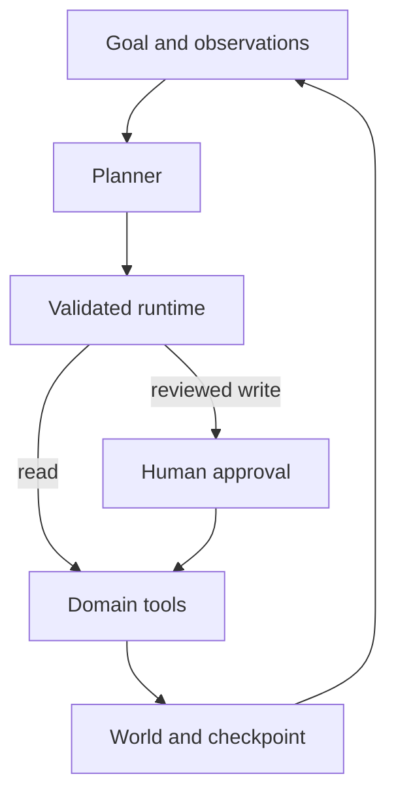

# Minute Keeper Agent

[](https://github.com/blueRav/minute-keeper-agent/actions/workflows/ci.yml)

Turn explicit meeting commitments into persistent, reviewable task memory.

A runnable portfolio prototype by Antoine Morales. JavaScript ESM, Node.js 22+, no third-party runtime dependencies. All included data and effects are synthetic.

## What it demonstrates

**Persistent memory, evidence grounding, reconciliation, human-reviewed exports.**

The kickoff records two explicit commitments. A review meeting changes API-14's deadline. The agent recalls previous tasks, updates the current deadline, preserves the earlier value, and requests approval before exporting local ticket records. All people and transcripts are synthetic.

## Run locally

```bash
git clone https://github.com/blueRav/minute-keeper-agent.git
cd minute-keeper-agent
npm ci --ignore-scripts
npm test
npm run demo
node src/cli.mjs --resume --approve --reviewer Antoine
# Reuse persistent memory for a later meeting:
node src/cli.mjs --session review
node src/cli.mjs --resume --approve --reviewer Antoine
```

The default demo is deterministic and uses no API key. It writes the world and agent checkpoint to `.state/run.json`. Starting without `--resume` begins a new run; meeting sessions reuse memory when `--session` is supplied.

## Optional live model

Copy `.env.example` to `.env`, then set your own `OPENAI_API_KEY` and `OPENAI_MODEL`. The model must support Responses API function tools. Run `npm run live`. This makes billable model calls; all domain tools still operate on the same synthetic data.

Live runs can also pause for approval. Review the saved pending action, then use `node src/cli.mjs --resume --approve --reviewer YOUR_NAME`. The checkpoint remembers the live mode.

Offline CI mocks the provider; it does not validate a live model's quality or availability.

## Behavioral controls

- Explicit owners, titles, dates, task ids, and source quotes are required.
- Suggestions without an owner and date are omitted.
- Newer observations revise memory while retaining prior deadlines.
- Active-session scoping rejects unrelated meeting reads.
- Ticket export pauses for review and updates synthetic local records.

## Architecture



See [runtime design](docs/runtime.md) for the execution boundary and [development notes](docs/development.md) for the workflow. [Sample trace](examples/sample-run.json) shows the actual deterministic run, including tool results and terminal state.

## Repository map

| Path | Purpose |
| --- | --- |
| `src/project.mjs` | Domain tools, fixtures, and observation-driven planner |
| `src/agent.mjs` | Bounded loop, schema validation, approval gates, receipts |
| `src/provider.mjs` | Optional Responses API planner |
| `src/cli.mjs` | Local demo and checkpoint persistence |
| `test/` | Runtime, domain, and subprocess tests |
| `examples/sample-run.json` | Reproducible offline result |

## Scope and limitations

The deterministic extractor supports a deliberately narrow commitment grammar. A general transcript parser, authenticated team scoping, conflict resolution for multiple owners, concurrency control, and a real ticket connector would need further work. No email, Teams message, or external ticket is sent.

Local checkpoint files are trusted inputs. Reviewer names are labels, not authentication. The token ceiling is checked after a model response and is not a strict spend cap. See [runtime design](docs/runtime.md) before attaching external systems.

## Related portfolio projects

- [Relay Ops Agent](https://github.com/blueRav/relay-ops-agent) — Investigate an incident, propose a rollback, pause for approval, and verify recovery.
- [Evidence Trail Agent](https://github.com/blueRav/evidence-trail-agent) — Retrieve sources, read evidence, and submit a brief with verifiable extractive citations.
- [Dataset Scout Agent](https://github.com/blueRav/dataset-scout-agent) — Plan a small regression experiment while enforcing leakage and holdout boundaries.
- [Agent Gauntlet](https://github.com/blueRav/agent-gauntlet) — Evaluate task completion and safety separately with synthetic adversarial cases and runtime probes.

## License

MIT. Developed with AI assistance; all behavior is open to inspection in the source and tests.
